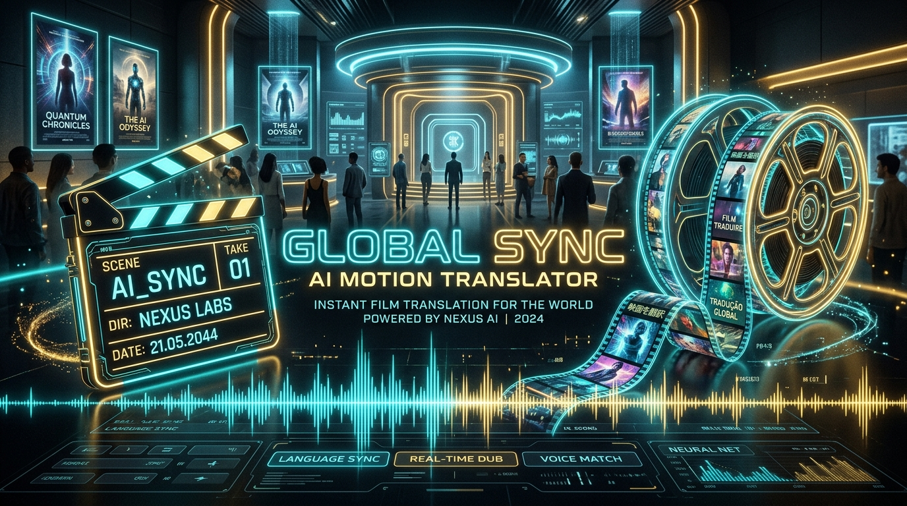

# 🎬 CineKhmer AI - Movie AI Translator to Khmer (ឧបករណ៍បកប្រែភាពយន្តជាភាសាខ្មែរ)

<div align="center">
  
  <br><br>
  <p><strong>ឧបករណ៍ឆ្លាតវៃ AI សម្រាប់បកប្រែ Subtitle ភាពយន្ត (SRT, VTT) និងតែងស្គ្រីបអត្ថាធិប្បាយសង្ខេបរឿងបែប Viral ទៅជាភាសាខ្មែរយ៉ាងរស់រវើក</strong></p>
  <p>AI-Powered Movie Subtitle & Script Localization Suite for Khmer (ភាសាខ្មែរ) with Live Video Subtitle Synchronization and Viral Movie Recap Generator.</p>
</div>

---

## 🌟 លក្ខណៈពិសេសចម្បង (Key Features)

### 1. 🎬 Subtitle Translator to Khmer (បកប្រែ Subtitle ភាពយន្ត)
- **គាំទ្រឯកសារ Subtitle ពេញលេញ**: អូសទម្លាក់ឯកសារ `.srt`, `.vtt`, ឬចម្លងបិទភ្ជាប់ (Paste) អត្ថបទដោយផ្ទាល់។
- **រក្សាកូដពេលវេលា (Timecodes)**: រក្សាពេលវេលា និងចន្លោះបង្ហាញបានត្រឹមត្រូវ ១០០%។
- **ទម្រង់បកប្រែច្រើនបែបបទ (Cinematic Styles)**:
  - 🎬 *ភាពយន្តរស់រវើក (Cinematic Dialogue)*: សន្ទនាបែបធម្មជាតិ មិនរឹងដូចម៉ាស៊ីន។
  - 🎙️ *ស្ទីលអ្នកអត្ថាធិប្បាយរឿង (Recap Narrator)*: ភាសាអធិប្បាយទាក់ទាញអារម្មណ៍។
  - ⚡ *សកម្មភាពញាប់រហ័ស (Intense Action)*: ពាក្យស្លោកប្រយុទ្ធ និងភាពបន្ទាន់។
  - 💖 *មនោសញ្ចេតនាស៊ីជម្រៅ (Emotional Drama)*: អារម្មណ៍ស៊ីជម្រៅ ស្នេហាកម្សត់។
  - 👑 *រឿងបុរាណ / រាជសព្ទ (Ancient / Royal Kingdom)*: ការប្រើប្រាស់ពាក្យរាជសព្ទត្រឹមត្រូវ។
- **Export ជម្រើសច្រើន**: ទាញយកជា `.srt` ខ្មែរ, Subtitle ពីរភាសា (Bilingual SRT), `.vtt`, ឬចម្លងទៅ Clipboard។

### 2. 🎙️ AI Movie Recap Generator (ស្គ្រីបអត្ថាធិប្បាយសង្ខេបភាពយន្ត AI)
- បំលែងសាច់រឿង ឬ Synopsis ទៅជាស្គ្រីបអ្នកអត្ថាធិប្បាយរឿង (Movie Recap) បែប **Viral** សម្រាប់ **TikTok, Facebook Reels និង YouTube**។
- កំណត់រយៈពេល៖ ១ នាទី (Shorts/Reels), ៣ នាទី (Standard Viral), ៨-១០ នាទី (Full Story)។
- បែងចែករចនាសម្ព័ន្ធស្គ្រីបដោយស្វ័យប្រវត្តិ៖
  - 🎯 **Viral Hook (បើកឆាកទាក់ទាញអារម្មណ៍)**
  - ⚡ **Plot Storytelling (ដំណើររឿងលម្អិត)**
  - 🔥 **Intense Climax (ឈុតកំពូល និងគ្រោះថ្នាក់)**
  - 🌟 **Moral & Cliffhanger (ការបញ្ចប់ និងពាក្យផ្តាំផ្ញើ)**

### 3. 📺 Live Video Player with Subtitle Synchronizer (ទស្សនាវីដេអូជាមួយ Subtitle ផ្ទាល់)
- ចាក់វីដេអូផ្ទាល់ខ្លួន (`.mp4`, `.webm`) ឬបើក **Cinema Canvas Simulator** គំរូ។
- បង្ហាញ Subtitle ខ្មែរ និង Subtitle ពីរភាសា (Bilingual Overlay) លើផ្ទៃវីដេអូតាមពេលវេលាជាក់ស្តែង (Real-time Sync)។
- ចុចលើបន្ទាត់ Subtitle ណាមួយ ដើម្បីរំលងវីដេអូទៅកាន់វិនាទីនោះភ្លាមៗ។

### 4. 🔊 Khmer Text-To-Speech (TTS) Voiceover Preview
- ចុចស្តាប់ការបញ្ចេញសំឡេងអានសាកល្បងដោយផ្ទាល់លើ Browser តាមរយៈ Web Speech API។
- មានចលនារលកសំឡេង (Audio Waveform Visualizer) និងប៊ូតុង Play/Pause។

### 5. 📖 វចនានុក្រមតួអង្គ & ភាពយន្ត (Character & Movie Glossary)
- កំណត់ឈ្មោះតួអង្គ (ឧ. `Peter Parker` -> `ភីធើ ផាកឃ័រ`) និងពាក្យស្លោកយោធា/សកម្មភាព (`Lock and load` -> `ត្រៀមអាវុធប្រយុទ្ធ`) ដើម្បីឲ្យការបកប្រែមានភាពស៊ីសង្វាក់គ្នាតាំងពីដើមដល់ចប់។

### 6. ⚡ ម៉ាស៊ីន AI ពីរជម្រើស (Dual AI Engines)
- **Built-in Free Engine**: ឥតគិតថ្លៃ គ្មានដែនកំណត់ មិនត្រូវការចុះឈ្មោះ ឬបញ្ចូល API Key។
- **Google Gemini Pro / Flash AI**: អាចបញ្ចូល Gemini API Key សម្រាប់ការយល់ដឹងពីបរិបទភាពយន្តកម្រិតខ្ពស់បំផុត។

---

## 🚀 របៀបតម្លើង និងប្រើប្រាស់ (Quick Start)

### ជម្រើសទី ១: ដំណើរការ Web Studio (ងាយស្រួលបំផុត)

1. បើក Terminal ក្នុងថត `d:\ToolAI` រួចវាយពាក្យ៖
   ```bash
   npm start
   ```
2. បើកកម្មវិធី Browser ទៅកាន់៖
   ```
   http://localhost:3000
   ```
3. (ជម្រើសបន្ថែម) អ្នកក៏អាចចុចបើកឯកសារ `index.html` លើ Browser ដោយផ្ទាល់បានផងដែរ!

---

### ជម្រើសទី ២: ប្រើប្រាស់តាម Command Line (Python CLI)

អ្នកអាចបកប្រែឯកសារ Subtitle ឬសរសេរស្គ្រីបសង្ខេបរឿងតាមរយៈ Python CLI៖

```bash
# ១. បកប្រែឯកសារ SRT ទៅជាភាសាខ្មែរ
python translate_movie.py --input samples/action_movie_sample.srt --output action_khmer.srt

# ២. បកប្រែជា Subtitle ពីរភាសា (English + Khmer)
python translate_movie.py --input samples/action_movie_sample.srt --bilingual

# ៣. ជ្រើសរើសទម្រង់បកប្រែ (cinematic, recap, action, dramatic)
python translate_movie.py --input samples/action_movie_sample.srt --style action

# ៤. បង្កើតស្គ្រីបអត្ថាធិប្បាយសង្ខេបរឿងពីសាច់រឿងសង្ខេប
python translate_movie.py --plot samples/recap_plot_sample.txt --recap --output recap_script.txt
```

---

## 📁 រចនាសម្ព័ន្ធគម្រោង (Project Structure)

```text
movie_ai_tool/
├── index.html                  # ទំព័រ Web App ចម្បង (Cinema Dark Glassmorphism UI)
├── style.css                   # ប្រព័ន្ធឌីហ្សាញទំនើប Vanilla CSS Design System
├── app.js                      # ម៉ាស៊ីនគណនា SRT/VTT, បកប្រែ, Video Sync & TTS
├── server.js                   # Node.js Local HTTP Server (Zero Dependencies)
├── translate_movie.py          # កម្មវិធី Python CLI សម្រាប់បកប្រែ Subtitle & Recap
├── package.json                # NPM Scripts & Configuration
├── README.md                   # ឯកសារណែនាំគម្រោង
├── assets/
│   └── banner.jpg              # រូបភាពតំណាងគម្រោង CineKhmer AI Banner
└── samples/
    ├── action_movie_sample.srt # គំរូ Subtitle ឈុតប្រយុទ្ធ Action Sci-Fi
    ├── action_movie_khmer.srt  # គំរូ Subtitle ដែលបានបកប្រែរួច
    └── recap_plot_sample.txt   # គំរូសាច់រឿងសម្រាប់តែងស្គ្រីបសង្ខេប
```

---

## 💻 បច្ចេកវិទ្យាដែលបានប្រើប្រាស់ (Tech Stack)

- **Frontend**: HTML5, Vanilla CSS3 (Custom Glassmorphism, CSS Custom Properties), Modern JavaScript (ES6+).
- **Typography**: Google Fonts (`Kantumruy Pro` សម្រាប់ភាសាខ្មែរ & `Outfit` សម្រាប់តួអក្សរឡាតាំង).
- **Backend / CLI**: Node.js HTTP Server, Python 3.12 (Standard Library `urllib`, `argparse`, `re`).
- **AI Integrations**: Free Google Translate Endpoint & Google Gemini 1.5 Flash API.

---

## 📜 អាជ្ញាប័ណ្ណ (License)

គម្រោងនេះត្រូវបានបង្កើតឡើងក្រោមអាជ្ញាប័ណ្ណ **MIT License**។ រាល់ការប្រើប្រាស់ និងកែច្នៃ គឺត្រូវបានអនុញ្ញាតដោយសេរី។
